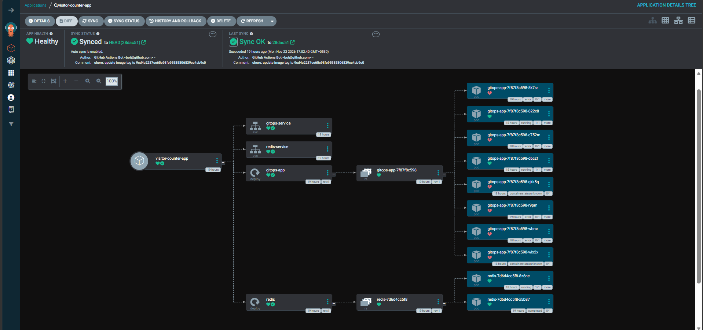
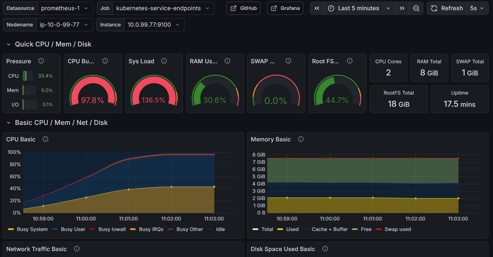
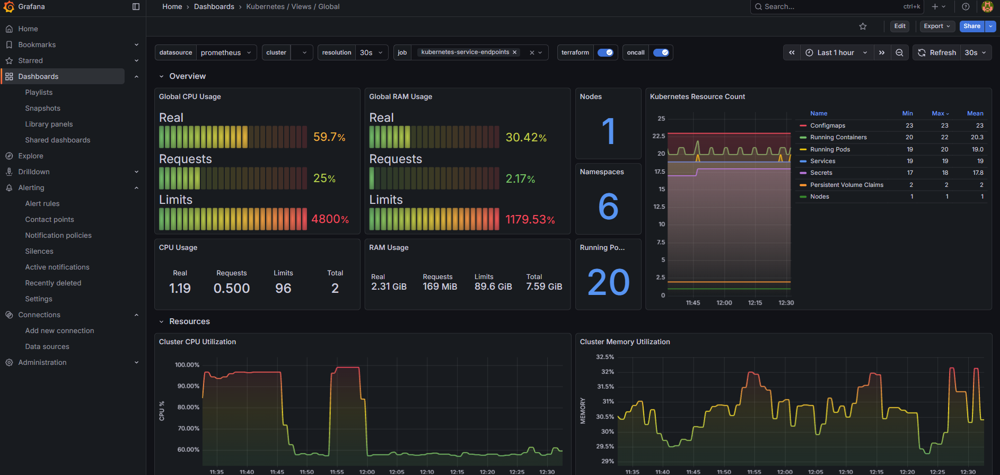
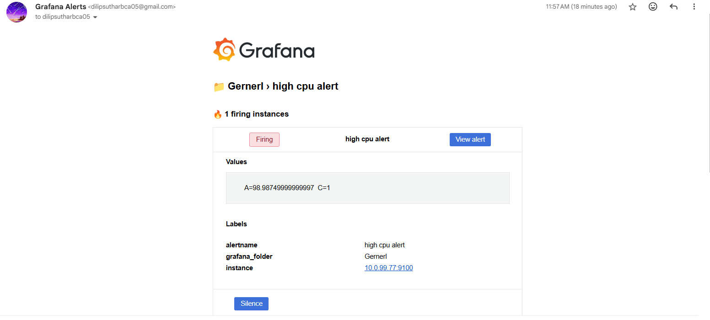

# GitOps CI/CD & Observability Pipeline on Kubernetes

A production-style **GitOps and monitoring pipeline** that deploys a stateful application (**Flask + Redis**) to a **K3s Kubernetes cluster on AWS EC2**. Delivery is automated with **GitHub Actions** and **ArgoCD**, and the cluster is monitored with **Prometheus** and **Grafana**, with **Gmail SMTP** alerts for high CPU.


---

## At a Glance (for recruiters)

| | |
|---|---|
| **What it does** | A `git push` builds, publishes and deploys the app to Kubernetes automatically, with no manual `kubectl`. |
| **Why it matters** | Git is the single source of truth. Every deployment is versioned, auditable and easy to roll back. |
| **Monitoring** | Live node and pod dashboards in Grafana, plus an email alert when CPU crosses a threshold. |
| **My role** | Designed and built everything: infrastructure, CI pipeline, GitOps deployment, monitoring and alerting. |

### Skills demonstrated

| Area | What I did | Tools |
|---|---|---|
| **CI** | Built a pipeline that builds a non-root Docker image and pushes it to Docker Hub | GitHub Actions, Docker |
| **GitOps / CD** | CI updates the image tag in Git; ArgoCD detects it and syncs the cluster | ArgoCD |
| **Kubernetes** | Deployed a stateful Flask + Redis app with Deployments, Services and health probes | K3s, kubectl |
| **Cloud** | Hosted the cluster on an AWS EC2 instance | AWS EC2, EBS |
| **Observability** | Installed Prometheus and Grafana, used node and pod dashboards | Helm, Prometheus, Grafana |
| **Alerting** | Configured a high-CPU alert with email notification and tested it with a CPU load test | Grafana, Gmail SMTP |
| **Security basics** | Non-root container, secrets kept out of Git | Docker, Kubernetes Secrets |

---

## Architecture and Workflow

1. **Continuous Integration:** A developer pushes code to GitHub. **GitHub Actions** builds a non-root Docker image and pushes it to Docker Hub.
2. **GitOps Sync (CD):** The workflow updates the image tag in `k8s/app-deployment.yaml` and commits it. **ArgoCD** watches the `k8s/` directory, detects the change and syncs the K3s cluster automatically using rolling updates.
3. **Observability and Alerting:** **Prometheus** scrapes node, cluster and pod metrics. **Grafana** visualizes them (dashboards `1860` and `15760`). When CPU usage crosses the configured threshold, Grafana sends an email through **Gmail SMTP**.

```text
Developer -> GitHub -> GitHub Actions -> Docker Hub
                            |
                            v  (commits new image tag)
                       k8s/ manifests -> ArgoCD -> K3s on AWS EC2
                                                        |
                                    Prometheus -> Grafana -> Gmail alert
```

---

## Tech Stack

| Category | Tools |
|---|---|
| **Cloud** | AWS EC2 (`t3.medium`, Ubuntu, 20 GB EBS) |
| **Application** | Python (Flask), Redis |
| **Containers** | Docker (non-root user) |
| **Orchestration** | Kubernetes (K3s), Helm |
| **CI/CD (GitOps)** | GitHub Actions, ArgoCD |
| **Monitoring and Alerting** | Prometheus, Grafana, Gmail SMTP |

---

## Screenshots

### 1. ArgoCD: Application Healthy and Synced


### 2. Grafana: Node Monitoring and Live CPU Load Test (Dashboard `1860`)


### 3. Grafana: Kubernetes Pod Monitoring (Dashboard `15760`)


### 4. High-CPU Email Alert (Gmail SMTP)


---

## Repository Structure

```text
gitops-portfolio-project/
├── .github/workflows/
│   └── ci.yaml                  # GitHub Actions: build image, push, update manifest
├── app/
│   ├── app.py                   # Flask app with health endpoints
│   ├── requirements.txt         # Python dependencies
│   └── Dockerfile               # Non-root Dockerfile
├── k8s/                         # Manifests watched by ArgoCD
│   ├── redis.yaml               # Redis Deployment and Service
│   ├── app-deployment.yaml      # Flask Deployment (image tag updated by CI)
│   └── app-service.yaml         # Flask NodePort Service
├── argocd/
│   └── application.yaml         # ArgoCD Application definition
├── monitoring/
│   └── grafana-smtp.yaml        # Helm values: NodePort and SMTP (sanitized)
└── screenshots/                 # Architecture and dashboard screenshots
```

---

## How to Run It

### Prerequisites
- An AWS account and an EC2 instance (Ubuntu, `t3.medium` or larger, security group allowing the NodePorts you use)
- A Docker Hub account
- A Gmail account with an **App Password** (for SMTP alerts)

### 1. Install K3s on the EC2 instance
```bash
curl -sfL https://get.k3s.io | sh -
sudo kubectl get nodes
```

### 2. Install ArgoCD
```bash
kubectl create namespace argocd
kubectl apply -n argocd -f https://raw.githubusercontent.com/argoproj/argo-cd/stable/manifests/install.yaml
```

### 3. Create the ArgoCD Application
```bash
kubectl apply -f argocd/application.yaml
```
ArgoCD now watches the `k8s/` directory and deploys Redis and the Flask app.

### 4. Configure GitHub Actions secrets
In the repository, go to *Settings > Secrets and variables > Actions* and add:

| Secret | Purpose |
|---|---|
| `DOCKERHUB_USERNAME` | Docker Hub login |
| `DOCKERHUB_TOKEN` | Docker Hub access token |

Also allow the workflow to push to the repo (*Settings > Actions > General > Workflow permissions > Read and write*), so it can commit the new image tag.

### 5. Install Prometheus and Grafana
```bash
helm repo add prometheus-community https://prometheus-community.github.io/helm-charts
helm repo update
helm install monitoring prometheus-community/kube-prometheus-stack \
  -n monitoring --create-namespace \
  -f monitoring/grafana-smtp.yaml
```
Add your SMTP credentials through a Kubernetes Secret or a local, untracked values file. **Never commit real credentials.**

### 6. Open Grafana and import dashboards
Open Grafana on its NodePort, then import dashboards **1860** (Node Exporter Full) and **15760** (Kubernetes pods).

### 7. Test the pipeline and the alert
- Change something in `app/` and push. Watch GitHub Actions build the image and ArgoCD sync the new version.
- Generate CPU load on the node (for example with `stress` or `stress-ng`) and watch the dashboard and the alert email.

---

## Alerting

| Item | Value |
|---|---|
| **Condition** | Node CPU usage above **80%** for **2 minutes** |
| **Channel** | Email through Gmail SMTP |
| **Tested with** | CPU load test, see screenshots 2 and 4 |

---

## Key Learnings

- With GitOps, deployments become Git commits: reviewable, traceable and reversible.
- ArgoCD removes the need to give CI direct access to the cluster.
- Dashboards show what is happening; **alerts** tell you when to look.
- Never commit credentials. Use Secrets and sanitized values files.

---

## Limitations and Future Improvements

This is a learning and portfolio project, not a full production setup. Known gaps and the next steps I would take:

- **High availability:** the cluster is a single K3s node. Next: a multi-node cluster or managed EKS.
- **Ingress and TLS:** the app is exposed through NodePort. Next: an Ingress controller with cert-manager and HTTPS.
- **Infrastructure as Code:** the EC2 instance was created manually. Next: provision it with Terraform.
- **Redis persistence:** add a PersistentVolume so data survives pod restarts.
- **Application metrics:** current dashboards show infrastructure (node and pod) metrics. Next: expose a `/metrics` endpoint for request rate and latency.
- **Alerting:** move alert rules to code (`PrometheusRule`) and add Alertmanager with Slack.
- **Pipeline security:** add image scanning (Trivy) and a Kubernetes manifest linter to CI.
- **Scaling:** add a Horizontal Pod Autoscaler.

---

## Author

**Dilip Suthar**, DevOps and Cloud Engineer (AWS, Terraform, Kubernetes, CI/CD)

- GitHub: [github.com/dipuSuthar](https://github.com/dipuSuthar)
- LinkedIn: [linkedin.com/in/dilip-suthar-124b9a235](https://linkedin.com/in/dilip-suthar-124b9a235)
- Portfolio: [madebydilip.vercel.app](https://madebydilip.vercel.app)
- Email: dilipsutharbca05@gmail.com
